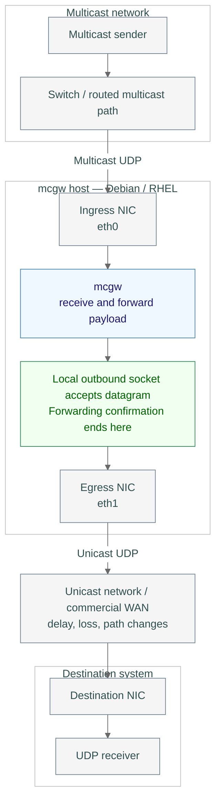
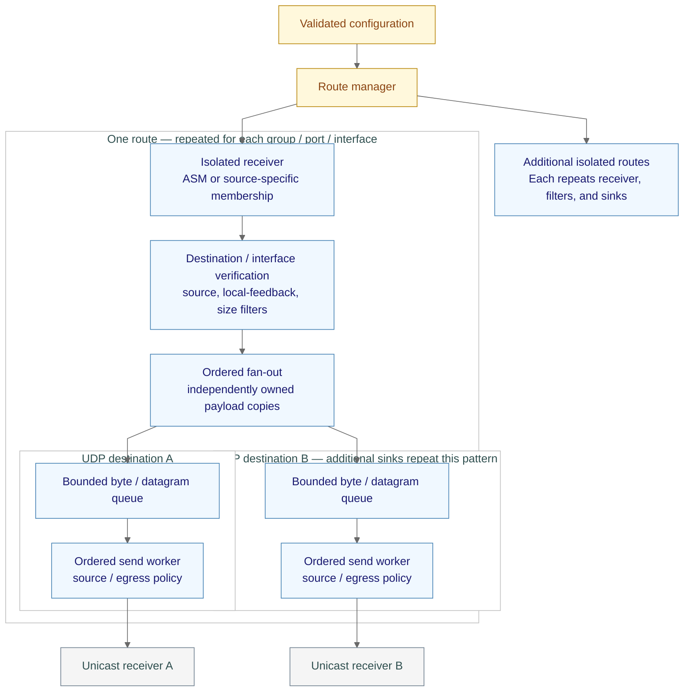
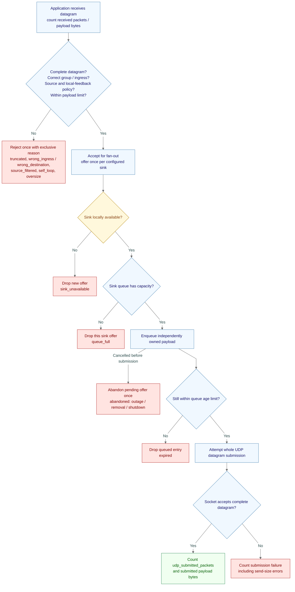
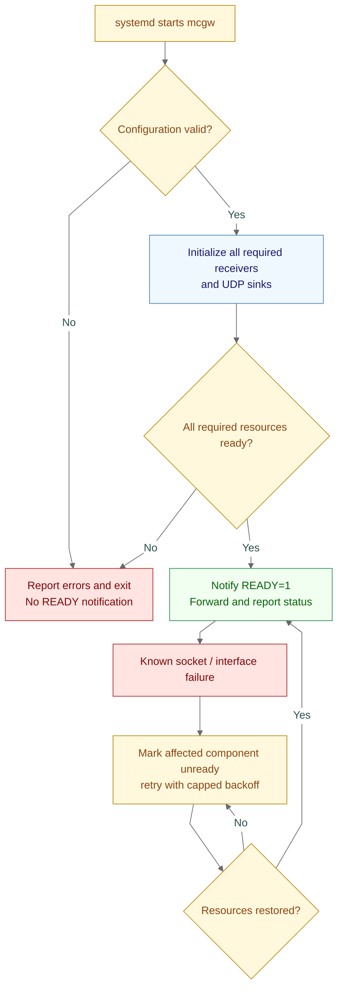
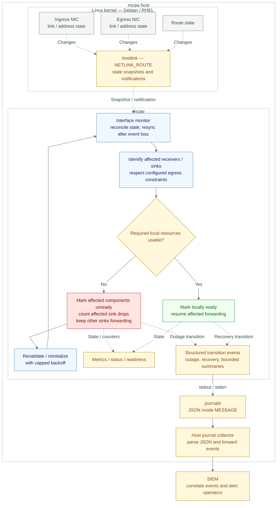
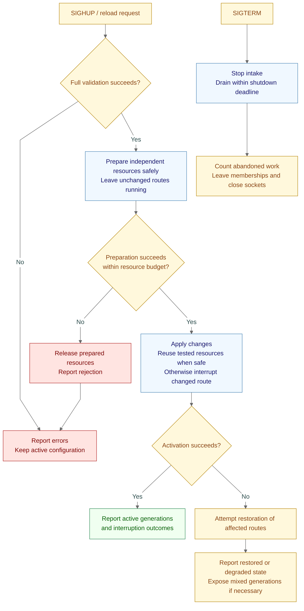

# mcgw architecture

**Status:** agreed design direction; implementation and prototype gates remain open.

**Contents**

- [1. Executive summary](#1-executive-summary)
- [2. Layer 1 — Network and host boundaries](#2-layer-1--network-and-host-boundaries)
- [3. Layer 2 — Routes and independent destinations](#3-layer-2--routes-and-independent-destinations)
- [4. Layer 3 — Datagram outcomes](#4-layer-3--datagram-outcomes)
- [5. Layer 4 — Lifecycle and recovery](#5-layer-4--lifecycle-and-recovery)
- [6. Configuration and CLI](#6-configuration-and-cli)
- [7. Design decisions and rationale](#7-design-decisions-and-rationale)
- [8. Open implementation choices and validation](#8-open-implementation-choices-and-validation)
- [9. Site pilot checklist](#9-site-pilot-checklist)
- [10. Deferred capabilities](#10-deferred-capabilities)
- [Appendix A — Acronyms and abbreviations](#appendix-a--acronyms-and-abbreviations)
- [References](#references)

## 1. Executive summary

mcgw is a Linux daemon that joins IPv4/IPv6 multicast groups and forwards
unchanged UDP payloads to configured unicast destinations. It targets Debian
and RHEL hosts and VMs. Separate sites operate independently.

A **sink** is a configured output that receives datagrams from a route. In v1,
each sink sends to one unicast UDP destination and has its own queue, send worker,
and outcome counters. A route can feed multiple sinks. Future sink types may
include TCP outputs and recording files.

| Term | Meaning |
|---|---|
| Route | Input multicast group, UDP port, and ingress interface, plus its outputs |
| ASM | Any-Source Multicast: receive from any sender, subject to configured filters |
| SSM | Source-Specific Multicast: membership selects a sender and group |
| PMTU | Path Maximum Transmission Unit: packet-size limit along an outbound path |
| rtnetlink | Linux kernel interface for link, address, and route state/events |
| SIEM | Security Information and Event Management system; consumes collected logs and applies alert rules |

| Topic | Contract |
|---|---|
| Purpose | One-way, many-to-many multicast-to-unicast UDP forwarding |
| Interfaces | Receive and send through the same NIC or different NICs |
| Forwarding confirmation | Complete UDP datagram accepted by the local outbound socket |
| Payload | Opaque bytes; no content transformation |
| New packets | Outbound IP headers and source endpoints belong to mcgw |
| Visibility | Per-route reception and per-destination submission/drop/error outcomes |
| Network boundary | No proof of host egress, destination receipt, or application processing |
| Pre-send checks | Validate configuration and required local interfaces/socket setup; rely on Linux routing; no end-to-end path or receiver probe before sending |
| Exclusions | Multicast routing, return-path relay, jitter smoothing, resequencing, retransmission, destination acknowledgments |
| Caveats | WAN loss/reordering, MTU, congestion, firewall policy, membership infrastructure, host resource limits |
| Implementation | Go first; optimize measured bottlenecks before considering another language |

### Release scope

| Capability | Initial release (v1) | Later / unscheduled |
|---|---|---|
| Receive | IPv4/IPv6 ASM and SSM; source and size filters | None planned. Possible future inputs may include:<br/>Broadcast UDP — receive subnet broadcasts<br/>Unicast UDP — receive datagrams addressed to mcgw<br/>Gateway tunnel / relay — receive traffic from another gateway |
| Forward | Same-family unicast UDP; independent destinations; explicit egress option | TCP listener — compatible clients connect to mcgw to receive framed datagrams<br/>Cross-family — forward IPv4 payloads over IPv6, or vice versa<br/>Multicast/broadcast sinks — send to output groups or subnet broadcasts |
| Operate | Config validation, controlled reload, bounded shutdown, systemd | Management CLI — inspect daemon state from the command line<br/>Unix socket API — provide a local management endpoint controlled by filesystem permissions |
| Observe | Metrics, liveness, readiness, minimal read-only route/sink status | RTP inspection — report sequence gaps and jitter without changing payloads<br/>Sampled watch — view a bounded sample of live traffic<br/>Source inventories — list observed senders per route |
| Test | UDP fixture sender, black-box integration tests, benchmark harness | Replay command — feed captured UDP payloads through configured routes<br/>Broader capture support — read additional capture formats and link types |
| Record / relay | Outside v1 | Capture/rotation — record traffic to files with size/time rotation and retention<br/>Discovery relay — carry announcements and replies between networks |

### Deployment inputs

| Input | Known constraint |
|---|---|
| Sites | A few independent sites; workload numbers unknown |
| WAN | Commercial links; persistently high or low latency; variable delay and path changes |
| Media | No wireless |
| Router | Cisco C8570-G2, IOS XE 17.18.x |
| Switches | Cisco 9300/9400, 17.18.4 / 17.15.6 |
| Firewall | Palo Alto possible; model/version to be recorded |
| Qualification | Equipment list is context, not a certified compatibility matrix |

## 2. Layer 1 — Network and host boundaries

Separate NICs are illustrated; same-NIC forwarding is also supported.
<table>
  <thead>
    <tr><th>Visual element</th><th>Color sample</th><th>Meaning</th></tr>
  </thead>
  <tbody>
    <tr><td>Gray</td><td style="background-color: whitesmoke; color: darkslategray;">whitesmoke</td><td>Network components</td></tr>
    <tr><td>Blue</td><td style="background-color: aliceblue; color: midnightblue;">aliceblue</td><td>Processing</td></tr>
    <tr><td>Green</td><td style="background-color: honeydew; color: darkgreen;">honeydew</td><td>Successful local operation or ready state</td></tr>
    <tr><td>Rose</td><td style="background-color: mistyrose; color: maroon;">mistyrose</td><td>Failure or drop</td></tr>
    <tr><td>Amber</td><td style="background-color: cornsilk; color: saddlebrown;">cornsilk</td><td>Control or status</td></tr>
    <tr><td>Boundary</td><td style="background-color: white; color: darkslategray;">white</td><td>Host, network, route, or sink grouping</td></tr>
    <tr><td>Labels</td><td>—</td><td>Carry meaning independently of color</td></tr>
    <tr><td>Solid arrows</td><td>—</td><td>Flow</td></tr>
    <tr><td>Dotted arrows</td><td>—</td><td>State observations or event notifications</td></tr>
  </tbody>
</table>

Color-cell fills require inline HTML styling support; viewers that strip it
(such as GitHub) retain the names/meanings but may omit the fills.



The path beyond socket acceptance is shown for context; mcgw does not confirm
those later stages. Payload bytes survive forwarding; original network headers do not.

## 3. Layer 2 — Routes and independent destinations

A route identifies a multicast group, UDP port, and ingress interface. Each sink
identifies one unicast destination. Two sinks are representative; more are allowed.



| Property | v1 behavior |
|---|---|
| Ownership | Copy payloads into sink-owned queue entries; immutable while in use |
| Bounds | Every queue has byte/datagram limits and maximum unstarted-packet age measured with monotonic time |
| Isolation | A blocked/failed destination cannot block receiver dispatch to others |
| Queue full | Drop the new offer for that sink; count `queue_full` |
| Expired | Drop unstarted entries past their age limit; count `expired` |
| Ordering | Preserve observed receive order per route/sink among surviving datagrams |
| Memory | Reject queue budgets over configured allocation budget; account separately for sockets, receive buffers, and runtime overhead |
| Optimization | Shared immutable storage only if profiling justifies its added ownership complexity |
| Send batches | Count only successful returned entries; account explicitly for the unsent remainder |
| Send bounds | Cancellable/nonblocking operations with a finite submission deadline; transient failures terminate or retry only within that deadline |
| Offer identity | Bind each offer to its original sink instance; never retarget pending work to a replacement destination |
| Replacement / removal | Bounded drain when the old sink remains usable; otherwise counted abandonment; no overlapping workers that violate sink ordering |
| Reload memory | Allocation budget includes all live, prepared, draining, and rollback resources plus in-flight payload storage; reject preparation or interrupt affected routes if overlap cannot fit |

## 4. Layer 3 — Datagram outcomes



Counter names shown in diagrams and tables are illustrative until the metrics
contract is frozen. Count each offer's terminal outcome exactly once.

### Accounting contract

| Scope | Required evidence |
|---|---|
| Route | Received packets/bytes, exclusive rejections, fan-out accepted |
| Sink | Offered, submitted packets/bytes, failed, dropped by reason, pending |
| Kernel | Available receive-overflow observations; separate from application drops |
| Async network error | Separate event; do not invent a lost packet attribution |
| Identifiers | Stable route/sink IDs; configuration generations in status/events |
| Logs | Structured lifecycle/error summaries to stdout/stderr, captured by systemd in journald; repeated events rate-limited |
| Log retention | Host journald policy; no separate mcgw log file |
| View logs | `journalctl -u mcgw -f` |
| Cardinality | No unbounded source/client/generation metric labels |
| Reload counters | Unchanged route/sink instances preserve counters; no-op reload cannot reset them |
| Changed / removed sink | Retire old-instance outcomes after drain/abandonment; report replacement separately in status/events, with an explicit counter reset if a stable metric ID is reused |
| Restart | Process-local counters reset; no durable per-packet receipt journal |
| Empty UDP payload | Forward as a datagram; increment packet counts, add zero payload bytes, consume one queue frame slot |

At a drained or consistent snapshot:

```text
route: received = rejected + fanout_accepted
sink:  offered  = submitted + failed + dropped + pending
```

Pending includes queued and in-progress offers. Queue-full rejection, expiry, and
shutdown abandonment count as drops exactly once. Local submission success is
not revised into an invented packet-specific failure after an asynchronous error.
Kernel observations cannot account for every loss before application receipt.

### WAN and packet-size policy

| Condition | Behavior |
|---|---|
| Variable delay / reordering | Forward observed order; no original-order recovery |
| Link outage / congestion | Bounded queues and explicit drops; no unlimited retries or catch-up backlog |
| Input payload too large / truncated | Drop; never forward partial input |
| Datagram exceeds known outbound path budget | PMTU-aware settings must enforce no deliberate fragmentation/payload splitting; count locally reported size failures. Missing ICMP feedback can hide later path drops; socket defaults are not the contract |
| Fan-out | Capacity plan includes all copies: 100 Mbps input × four destinations ≈ 400 Mbps payload output |
| High baseline latency | Does not by itself prove congestion or justify rejoin |
| Pacing | Optional per-sink rate limits only if needed; fixed pacing is not adaptive congestion control |

## 5. Layer 4 — Lifecycle and recovery

### Startup and runtime recovery



Silence alone does not trigger this failure path. Watchdog notification must
reflect useful daemon/control-loop progress, including healthy idle operation.

### Interface monitoring and forwarding outages

rtnetlink (`NETLINK_ROUTE`) is available in Linux on both Debian and RHEL.
mcgw monitors relevant links, addresses, and routes; it does not alter them.
Validate subscription permissions under the selected service restrictions.
References: [review sources S12–S14](architecture-review.md#appendix-a--online-research-sources).

| Condition | Forwarding and status behavior |
|---|---|
| Ingress usable, constrained egress down/deleted | Keep receiving; affected sinks become unready; other usable sinks continue |
| New offers while sink unavailable | Count and drop immediately as `sink_unavailable`; do not build an outage backlog |
| Queued offers on known egress loss | Abandon with counted drops; cancel pending operations within their finite deadline |
| In-flight send races with failure | Use actual operation outcome: accepted datagram counts as submitted; failed/cancelled offer counts once; link events do not retrospectively establish packet loss |
| Normal Linux routing | Reevaluate affected sink setup/path; a lost NIC alone does not invalidate a sink if another permitted route remains usable |
| Explicit egress constraint | No silent fallback to another interface |
| Address removal / interface recreation | Re-resolve bindings and interface identity; reinitialize affected sockets/memberships |
| Interface restored | Resume only after required local resources revalidate/reinitialize; remote reachability remains unknown |
| Ingress unavailable | Mark receiver unready, report event, restore membership when interface returns; no new application receives to account for during the gap |
| Daemon status | Liveness can remain healthy; readiness fails while required components are unavailable |
| Monitoring startup / event loss | Take an initial state snapshot and reconcile notifications; resynchronize after loss/overflow; expose monitoring degradation rather than silently trust stale state |
| Link interpretation | Distinguish administrative state, carrier/operational state, and unknown states; qualify behavior for virtual interfaces; interface up does not prove WAN health |




### Reload and shutdown



Reload is not promised lossless or globally atomic. Validation cannot reserve
all activation resources. Preparation failure, including a reload overlap that
exceeds the allocation budget (§3), releases prepared resources and rejects the
reload before activation begins; the active configuration keeps running. Desired configuration, per-route active generation,
activation failures, and failed rollback remain visible.

### Health and status

All endpoints share a loopback HTTP listener by default: `127.0.0.1:9310`.
External binding is explicit and requires operator-provided access controls
(firewall/network restrictions or an authenticated proxy). v1 does not provide
built-in HTTP authentication/TLS; do not expose the listener to an untrusted WAN.

| Endpoint / dimension | Meaning |
|---|---|
| `/healthz` | HTTP 200 while process/control-loop progress is healthy; 503 if progress is unhealthy and the server can respond; independent of freshness |
| `/readyz` | HTTP 200 when all required ingress receivers and local sinks are usable; otherwise 503; no response is not a healthy result |
| `/metrics` | Route/sink counters, states, queue occupancy, overflow observations |
| `/status` | Minimal read-only JSON; route/sink IDs, desired/active generations, actual local source IP/port, ingress/egress bindings, failures, freshness |
| Freshness disabled | Idle/event-driven route has no expected traffic cadence |
| Freshness enabled | Track from successful join; distinguish never-seen, fresh, stale |
| UDP sink ready | Local setup succeeded; remote reachability remains unknown |
| Destination verification | No active probe to confirm the full path or that the receiver is online/listening; local UDP acceptance is not reachability evidence |
| Sink history | Last submission and recent errors reported separately from readiness |
| Terminology | Ingress receiver = mcgw input component; destination receiver = remote application/system. Sink = configured output, not the destination itself |
| State versus readiness | `unavailable` is a component state; unready means that state fails its readiness check. Illustrative JSON may use `unavailable` without defining a second state machine |
| Required policy | Pending OD-02, treat every configured ingress receiver/sink as required for aggregate readiness; no optional-component field is promised |
| Startup policy | Existing fail-start policy remains until OD-01 resolves; bounded initialization waiting remains open |
| Rejoin | Stale-triggered rejoin disabled by default; any opt-in behavior requires limits/backoff |
| Management bounds | Bounded concurrent connections and in-flight requests; finite header-read, read, write and idle timeouts; bounded response size and serialization memory. Numeric limits are OD-12/OD-15 work |
| Snapshot isolation | Responses are built from a snapshot copied under short-held locks; forwarding, control and reload locks are never held while encoding or writing to a client. A slow or stalled client cannot delay forwarding, interface recovery or reload |

### Journal events and SIEM integration

| Item | Contract |
|---|---|
| Transport | Structured JSON records to stdout/stderr; systemd captures them in journald |
| Parsing | JSON fields are inside journal `MESSAGE`; they are not native journal fields; the collector must parse them |
| Severity | Explicit JSON `severity`; do not assume it sets native journal `PRIORITY` |
| Outage | Error event when a required receiver/sink becomes unavailable; emit it even when no traffic is arriving (best effort within the logging bounds below) |
| Recovery | Informational event after local revalidation; no claim of destination delivery |
| Flapping | Bounded transition logs and periodic suppressed-event/outage summaries; no per-dropped-packet log flood |
| Event fields | Timestamp, event, severity, reason, host identity, route/sink IDs where applicable, interface name/index, destination, old/new state, configuration generation |
| Recovery summary | Outage duration and counted affected sink drops; ingress losses before application receipt remain unknown |
| Collection | Host journal collector forwards records; SIEM owns correlation, alert routing, and notification |
| Delivery limitation | Journal/collector retention, rate limits, or outages can lose/delay events; metrics and status remain independent local evidence |
| Logging isolation | Rate limits do not bound a single blocked stdout/stderr write. Records pass through a bounded queue drained by an independent writer; forwarding, control and interface-recovery paths never wait on log output and hold none of their locks during writes |
| Overflow and failure | A full queue or blocked/broken output drops records with counted overflow and write-failure metrics and a later summary event when output resumes |
| Record integrity | Each record is serialized and written whole; concurrent records do not interleave |
| Shutdown flush | Remaining records are flushed within a finite deadline, then abandoned with a count |

Illustrative record; field names will be frozen in the observability contract:

```json
{"event":"sink_unavailable","severity":"error","reason":"egress_link_down","interface":"eth1","route":"sim","sink":"sim-secondary","destination":"10.0.20.6:3000","old_state":"ready","new_state":"unavailable"}
```

## 6. Configuration and CLI

**Illustrative shape, not a frozen schema.** Resource/timeout values below are
examples, not established defaults. Exact names and defaults require contract review.

```yaml
listen:
  http: "127.0.0.1:9310"
defaults:
  max_datagram: 9000               # UDP payload ceiling, not a WAN MTU guarantee
  socket_rcvbuf: 8MiB             # requested value; expose effective value
routes:
  - name: sim
    group: 239.1.1.1
    port: 3000
    interface: eth0               # ingress; address alias may resolve to a name
    source_allow: [192.168.10.20]  # application allow-list; ASM membership
    sinks:
      - name: sim-primary
        udp: 10.0.20.5:3000        # normal Linux routing
      - name: sim-secondary
        udp: 10.0.20.6:3000
        bind: 10.0.20.1:8930       # local source endpoint
        egress_interface: eth1    # enforce or report failure; no silent fallback
  - name: source-specific
    group: 232.1.1.1
    port: 3000
    interface: eth0
    membership_source: 192.168.10.20 # source-specific membership; not source_allow
    sinks:
      - name: source-specific-primary
        udp: 10.0.20.7:3000
  - name: sensors-v6
    group: "ff15::1:6969"
    port: 6969
    interface: eth0
    sinks:
      - name: sensors-primary
        udp: "[2001:db8:20::5]:6969"
        egress_interface: eth1
```

The final schema must also express queue byte/datagram/age bounds, total queue
allocation budget, shutdown/retry limits, optional freshness expectations, and
local-feedback policy. `source_allow` and `membership_source` illustrate separate
controls; their names and allowed combinations remain a schema decision (OD-09).
An SSM membership cannot be replaced silently with ASM plus application filtering.
No numeric defaults are settled by this example.

| Command | v1 behavior |
|---|---|
| `mcgw run [-c FILE]` | Run daemon; default config `/etc/mcgw/mcgw.yaml` |
| `mcgw check-config [-c FILE]` | Collect/report errors with file:line; exit nonzero on errors; do not join groups or start forwarding |

### Validation and network boundary

| Check | Required behavior |
|---|---|
| Structure | Reject unknown keys, invalid types, ranges, sizes, durations; report all recoverable errors |
| Addresses | Multicast input; unicast UDP output; same family per route/sink; valid scoped addresses |
| SSM | Require membership source for IPv4 232/8 and RFC 4607 IPv6 SSM range; use a precise tested parser, not a loose string-prefix check; verify IGMPv3/MLDv2 infrastructure [review sources S16](architecture-review.md#appendix-a--online-research-sources) |
| Source controls | Source-specific membership and application allow-list are independent concepts; source-specific joins outside designated SSM ranges need explicit network support and schema policy |
| Interfaces | Resolve name/address aliases; verify family addresses; normalize before duplicate checks |
| Uniqueness | Stable route/sink identifiers; no duplicate group:port:ingress tuples |
| Resources | Queue allocation budget, bind compatibility, listener conflicts, privilege requirements |
| Broadcast | Reject limited/directed broadcast using relevant prefix context; `.255` suffix alone is insufficient |
| Egress | Linux routing by default; explicit constraint must be enforced; source bind alone does not enforce NIC |
| Runtime | Activation can still fail after successful validation; report separately |

### Receive-path contract

Mechanism references: [review S2, S9, S11, S16, S24](architecture-review.md#appendix-a--online-research-sources). Exact API support is a qualification gate, not a claim about every Linux kernel.

| Concern | Required behavior / validation |
|---|---|
| Multicast cross-delivery | Suppress unrelated membership delivery using supported family-specific controls (`IP_MULTICAST_ALL=0`, `IPV6_MULTICAST_ALL=0` where available) plus tested bind policy; destination/interface ancillary checks remain a second boundary |
| Unsupported API | Fail qualification or document a tested equivalent; do not silently claim isolation from a missing option |
| Socket reuse | Only when needed for tested bindings; do not assume reuse balances multicast traffic. Overlapping memberships can duplicate traffic during reload |
| Acceptance tests | Same-port groups, same-group interfaces, unrelated host joins, wrong-interface injection, and SSM source mismatch |
| Kernel versus application filtering | Kernel rejection can protect queues but cannot be counted as application-received rejection; optional further kernel filters require evidence and explicit accounting boundaries |
| Receive queues | Expose requested/effective buffer sizes and overflow observations; queue-cap warnings/failure thresholds are OD-06 |

### Trust and availability boundaries

| Boundary | Current position |
|---|---|
| Publisher identity | Source allow-lists check addresses, not authentication; ingress network controls are operator-owned |
| Amplification | Each accepted input can produce N copies; capacity planning required; mandatory default rate ceilings remain OD-03 |
| Management trust | Loopback HTTP is not per-local-user authorization; external binding requires access controls |
| Availability | No built-in v1 HA; overlapping forwarding instances can create duplicates. Any redundancy deployment needs explicit loss/duplicate/fencing decisions under OD-13 |
| Deployment | See [deployment planning](mcgw-deployment.md) for prerequisites, systemd, hardening, and qualification |

### Local-loop guard

| Mechanism | Boundary |
|---|---|
| Static | Reject provable local configuration cycles on every load/reload |
| Runtime | Compare sources with registered actual local sink endpoints; count configured feedback rejections as `self_loop` |
| Endpoint tracking | Resolve wildcard binds against relevant local addresses; update on interface changes and reload overlap |
| Legitimate local sender | Explicit guard policy; avoid rejecting every bind merely because a route accepts any source |
| External reflector / NAT | Source may change; arbitrary multi-site cycle detection is not guaranteed |
| Payload | No hash-based universal deduplication; repeated identical payloads can be legitimate |
| Multicast loopback option | Not general loop protection for unicast sinks |

The exact guard policy/configuration is part of the pre-implementation contract.
Operators must avoid external forwarding cycles.

## 7. Design decisions and rationale

Accepted direction from the [architecture review](architecture-review.md).
The review remains the detailed decision history and acceptance-test reference.

| Decision | Rationale / tradeoff | Review |
|---|---|---|
| Account at local socket submission per destination | Meets confirmation need without claiming remote delivery; no per-packet durable journal | D1 |
| Route-selected or explicitly constrained egress | Supports different NICs; binding and routing remain distinct | D2 |
| Bounded sink-owned copies first | Simple lifetime/isolation model; costs copying bandwidth | D3 |
| Defer TCP | No confirmed initial need; framing/client lifecycle add failure modes | D4 |
| Narrow local-loop guarantee | Endpoint guards cannot identify every reflected opaque datagram | D5 |
| Controlled interruption for changed routes | Honest reload semantics; unaffected routes continue | D6 |
| Separate liveness, readiness, freshness | Idle traffic is legitimate; silence does not diagnose membership failure | D7 |
| Transparent UDP and bounded overload | No safe generic resequencing/splitting; queues cannot fix sustained overload | D8 |
| Prove family-specific socket isolation | Route keys alone do not establish kernel delivery behavior | D9 |
| Publish benchmark envelope | Workload unknown; input rate alone omits fan-out and host limits | D10 |
| Operator-managed host/network configuration | Avoid silent route/sysctl/firewall changes; qualify actual site topology | D11 |
| UDP-first v1 | Concentrates validation on confirmed forwarding and visibility needs | D12 |

### Using diagrams to guide development

Draw boundaries, ownership, and failure paths before implementing them. Each
arrow has a defined meaning; each failure branch has an observable outcome.

| Diagram element | Development consequence |
|---|---|
| Component boundary | Responsibility and interface |
| Queue | Ownership, capacity, expiry, and drop policy |
| Decision branch | Observable behavior and test case |
| Failure / recovery path | State transition, counter, and journal event |
| External system | Dependency and limit of mcgw's guarantees |

Prototypes verify that Linux and the implementation behave as the diagrams
assume. When evidence changes an assumption, update the diagrams, contracts,
and code together.

## 8. Open implementation choices and validation

The decisions above remain in force. The [open-decision register](mcgw-open-decisions.md)
tracks alternatives, tradeoffs, evidence, gates, status, and resolutions.

| Area | Decision records |
|---|---|
| Startup and required/readiness policy | [OD-01](mcgw-open-decisions.md#od-01), [OD-02](mcgw-open-decisions.md#od-02) |
| Rate policy, trust, and PMTU | [OD-03](mcgw-open-decisions.md#od-03), [OD-04](mcgw-open-decisions.md#od-04) |
| Send errors, receive storage, allocation/batching | [OD-05](mcgw-open-decisions.md#od-05), [OD-06](mcgw-open-decisions.md#od-06), [OD-07](mcgw-open-decisions.md#od-07) |
| Journal severity and SIEM parsing | [OD-08](mcgw-open-decisions.md#od-08) |
| Membership, isolation, egress, and OS qualification | [OD-09](mcgw-open-decisions.md#od-09), [OD-10](mcgw-open-decisions.md#od-10) |
| Reload, queue/timer defaults, and benchmark envelope | [OD-11](mcgw-open-decisions.md#od-11), [OD-12](mcgw-open-decisions.md#od-12) |
| Future redundancy requirements | [OD-13](mcgw-open-decisions.md#od-13) |
| Conditional output QoS and observability qualification | [OD-14](mcgw-open-decisions.md#od-14), [OD-15](mcgw-open-decisions.md#od-15) |

### Contracts to finish before implementation

| Contract | Completion requirement |
|---|---|
| Config | Field names/defaults, source filters, freshness and guard policy, allocation limits |
| Metrics/status/logs | Names/types, bounded labels, stable IDs, consistent snapshots, JSON status/event schemas, counter continuity, SIEM parsing, logging queue and management connection/timeout bounds |
| Lifecycle | Readiness transitions, watchdog progress, activation/rollback reporting, interface monitor resynchronization and outage/recovery events |
| Queue/send | Ownership, expiry, bounded/cancellable submission, transient retry policy, drop classification, partial batches, original sink attribution, reload overlap budget |
| Address handling | Exact SSM prefixes/APIs, scopes, family normalization, broadcast classification |
| Management access | Explicit external binding and operator-provided access controls |
| Interface state | Administrative/carrier/unknown classification; notification/snapshot reconciliation; delete/recreate identity handling |

### Benchmark envelope

| Item | Requirement |
|---|---|
| Provisional case | 1 Gbps UDP payload at 100k packets/s: approximately 1250 payload bytes per packet |
| Host | Identified 2-vCPU VM: CPU model, memory, kernel, NIC/virtualization |
| Matrix | Packet sizes, groups, fan-out, bursts, idle routes, required v1 features |
| Measure | CPU, memory, allocations/GC, receive overflow, sink outcomes, local receive-to-submission latency percentiles |
| Loss | Zero unexplained loss in declared healthy envelope; intentional overload drops identified |
| Independence | Distinguish generator/receiver losses from mcgw observations |
| Duration / latency | Select explicit duration and numeric local latency criterion before release benchmark |
| Rewrite | Profile and correct bottlenecks first; language change needs evidence of a Go-specific limit |

## 9. Site pilot checklist

| Record / test | Evidence |
|---|---|
| Topology | Ingress VLAN/NIC, source/group/port, outbound destination/source/NIC |
| Multicast | Membership versions/querier/snooping, source/group routing, sender TTL/hop limit, ingress firewall and IPv4 reverse-path filtering |
| Unicast | Routes/policy routing, path MTU, ICMP feedback, firewall permissions |
| Equipment | Actual models/software, including Palo Alto details; tested combinations |
| Service | Dedicated account; only demonstrated capabilities; no host IP forwarding requirement for ordinary receive/send |
| Management | Loopback by default; external access controls verified; no unauthenticated untrusted-WAN exposure |
| Two-NIC path | Payload integrity and socket endpoint/source selection under route changes |
| Failures | Quiet sender, no first packet, wrong source/interface, one failed sink, interface loss/restoration |
| Impairments | Delay, loss, reordering, small MTU, bottleneck; distinguish network effects from local submission outcomes |
| Operations | Reload conflicts, peak overlap allocation, rollback, shutdown, no-op counter continuity and watchdog progress |
| Interface recovery | Link down/up, source-address loss, interface deletion/recreation under the same name; monitoring resynchronization |
| Datagram boundaries | Empty payload, maximum accepted size, one byte over limit; integrity and packet/byte counters |
| Capacity plan | Before sustained deployment: measured/estimated input rates, bursts, fan-out, shared egress capacity/headroom, queue age/budget, and any pacing policy |
| Management and logging isolation | Stalled and slow HTTP clients, concurrent scrapes, and blocked or broken stdout/stderr during traffic, reload and interface recovery: forwarding and recovery continue, overflow is counted, shutdown stays finite |
| SIEM | Collector parses JSON messages; outage/recovery alerts and suppression summaries verified, including when input is idle |

mcgw does not automatically change host routes, sysctls, or firewall rules.
Ordinary receive/send does not make it a multicast router. Destination
acknowledgments and cooperating receivers are outside deployment requirements.

## 10. Deferred capabilities

No schedule or compatibility promise is implied by this table. Smaller optional
improvements are tracked in the [feature ideas backlog](mcgw-feature-ideas.md).

| Capability | Design work required before adding it |
|---|---|
| TCP listener | Reference decoder, version selection and framing (four-byte network-order length is a historical proposal, not frozen); zero-length payloads; client/queue byte/count/age caps; no-client outcome; drop-oldest only for unstarted frames; partial-write deadlines, disconnects, bounded shutdown |
| Recording | Capture boundary, timestamps/metadata/link type, synthetic headers, buffered versus durable writes, disk-full handling, retention/crash recovery |
| RTP inspection | Bounded source/RTP synchronization-source identifier (SSRC) tracking, reorder/duplicate/late handling, sequence wrap/restart, jitter definitions; isolated sample queues |
| Replay | Start with explicitly limited classic pcap if needed; unsupported format rejection; offline resource isolation; destination ambiguity and malformed/fragment handling; side-effect-free dry run |
| Relay / discovery | Return path and far-end multicast semantics; not enabled by forwarding announcements alone |
| Multicast / broadcast sinks | Egress/TTL/broadcast rules and additional loop analysis; more than lifting validation |
| Rich CLI / watch / interfaces | Protected API contract, bounded sampling, no forwarding interference |
| Cross-family forwarding | Explicit source/destination/MTU and validation matrix |

## Appendix A — Acronyms and abbreviations

Diagram node IDs and literal configuration/API field names are excluded.

| Term | Meaning | Use in mcgw |
|---|---|---|
| API | Application Programming Interface | Kernel interfaces and management endpoints |
| ASM | Any-Source Multicast | Membership without selecting one source |
| CLI | Command-Line Interface | `run` and `check-config` commands |
| CPU | Central Processing Unit | Processing capacity and benchmark measurements |
| GC | Garbage Collection | Runtime memory management measured during benchmarks |
| HTTP | Hypertext Transfer Protocol | Metrics, health, readiness, and status endpoints |
| ID | Identifier | Stable route/sink identity |
| IGMP | Internet Group Management Protocol | IPv4 multicast membership signaling |
| IP | Internet Protocol | Network addressing; IPv4 and IPv6 are versions 4 and 6 |
| JSON | JavaScript Object Notation | Structured status responses and journal messages |
| mcgw | Multicast gateway | Project and daemon name |
| MLD | Multicast Listener Discovery | IPv6 multicast membership signaling |
| MTU | Maximum Transmission Unit | Packet-size limit of a network link |
| NAT | Network Address Translation | Can change source endpoints seen by loop guards |
| NIC | Network Interface Card | Ingress/egress interface; may also be virtual |
| OS | Operating System | Debian/RHEL release and kernel qualification |
| PMTU | Path Maximum Transmission Unit | Packet-size limit across an outbound path |
| RHEL | Red Hat Enterprise Linux | Target Linux distribution |
| RTP | Real-time Transport Protocol | Deferred sequence/jitter inspection |
| rtnetlink | Routing netlink | Linux link, address, and route state/events interface |
| SIEM | Security Information and Event Management | Journal-event correlation and operator alerts |
| SIGHUP | Hangup signal | Request configuration reload |
| SIGTERM | Termination signal | Request bounded shutdown |
| SSM | Source-Specific Multicast | Membership for a specific source and group |
| SSRC | Synchronization source identifier | RTP source identity for deferred inspection |
| TB | Top to bottom | Mermaid flow direction |
| TCP | Transmission Control Protocol | Deferred framed-stream forwarding |
| TLS | Transport Layer Security | External HTTP protection, if supplied by a proxy |
| TTL | Time to Live | IPv4 lifetime field; relevant to future multicast sinks |
| UDP | User Datagram Protocol | Multicast input and unicast output transport |
| vCPU | Virtual Central Processing Unit | VM processing allocation used in benchmarks |
| VLAN | Virtual Local Area Network | Site ingress network segmentation |
| VM | Virtual Machine | Deployment and benchmark host type |
| RFC | Request for Comments | Published Internet technical specification series |
| pcap / pcapng | Packet capture / next-generation packet capture formats | Deferred capture/replay formats |
| WAN | Wide Area Network | Commercial intersite/unicast network paths |

Cisco IOS XE is a vendor software platform name; versions in this document
identify deployment context rather than an mcgw interface or protocol.

## References

- [Follow-up review dispositions](architecture-review.md#6-follow-up-review-dispositions): every finding from temp.md, its action or open decision, and rationale.
- [Deployment planning](mcgw-deployment.md): host/network prerequisites, service lifecycle, access, and site qualification.
- [Troubleshooting: receiver sees no data](mcgw-troubleshooting.md#receiver-sees-no-data): evidence-based operator walkthrough; mcgw diagnostics are planned until implemented.
- [Architecture review and research appendix](architecture-review.md#appendix-a--online-research-sources): Linux socket/transport references and RFCs supporting the agreed decisions.
