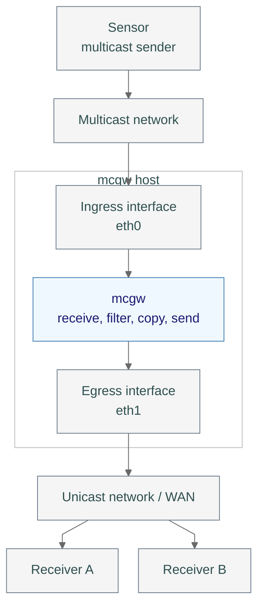
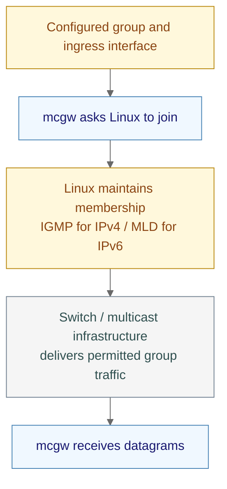
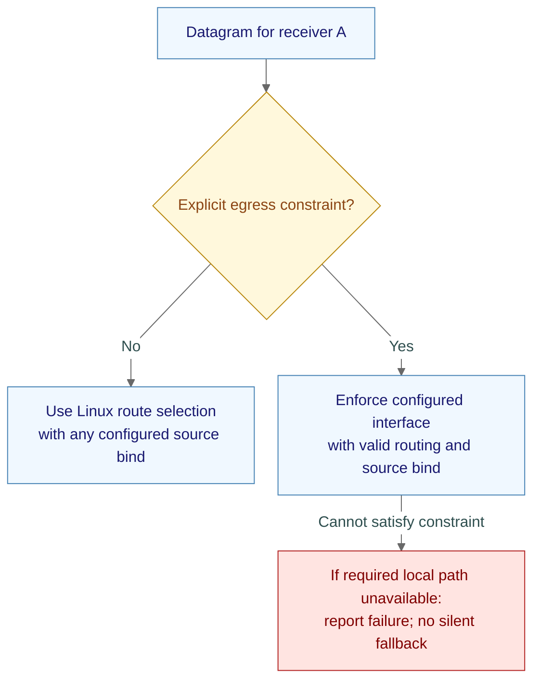
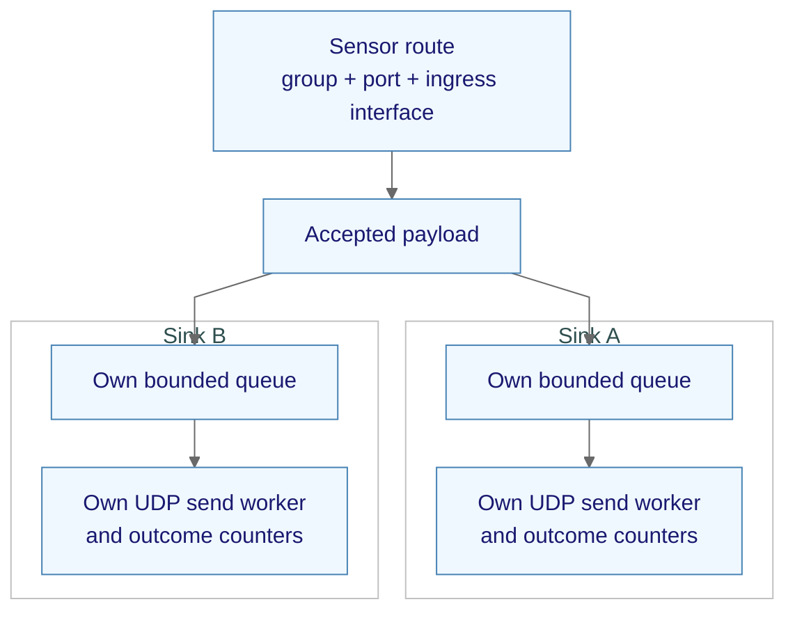
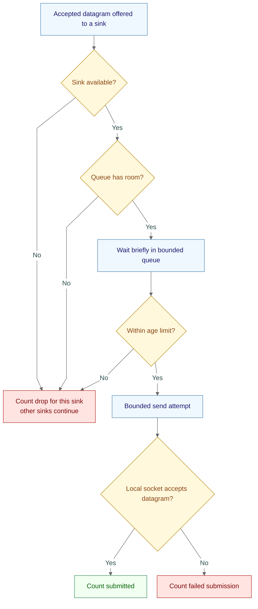
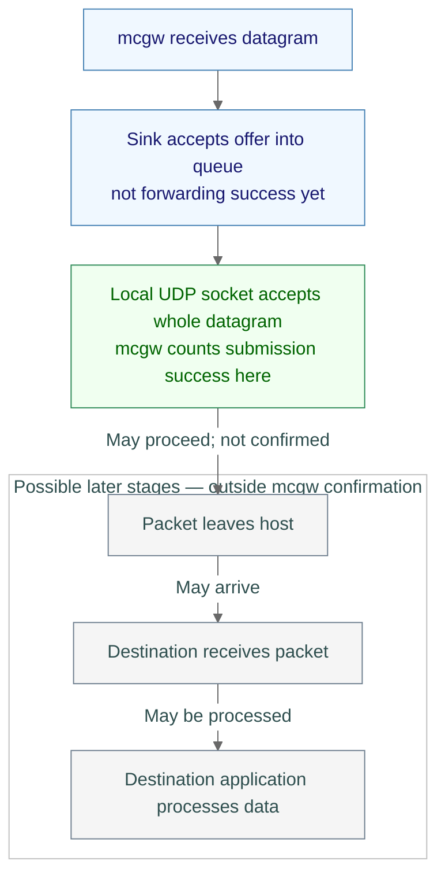
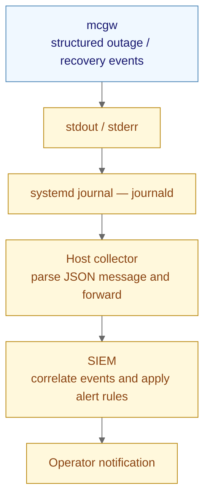

# mcgw concepts

mcgw means **multicast gateway**. It receives a network feed and sends unchanged
copies to configured destinations.

A primer for reading [mcgw architecture](architecture.md). Examples are
illustrative, not deployment settings. “v1” means the initial release design;
it does not mean the software is already implemented.

## Contents

- [The example](#the-example)
- [1. Packets, datagrams, and payloads](#1-packets-datagrams-and-payloads)
- [2. IP addresses and ports](#2-ip-addresses-and-ports)
- [3. Unicast, multicast, and broadcast](#3-unicast-multicast-and-broadcast)
- [4. Multicast membership](#4-multicast-membership)
- [5. Hosts and network interfaces](#5-hosts-and-network-interfaces)
- [6. Routing and source binding](#6-routing-and-source-binding)
- [7. mcgw routes, sinks, and fan-out](#7-mcgw-routes-sinks-and-fan-out)
- [8. UDP and TCP](#8-udp-and-tcp)
- [9. Latency, jitter, loss, and reordering](#9-latency-jitter-loss-and-reordering)
- [10. Queues, capacity, and backpressure](#10-queues-capacity-and-backpressure)
- [11. MTU and fragmentation](#11-mtu-and-fragmentation)
- [12. Forwarding versus delivery](#12-forwarding-versus-delivery)
- [13. Health and recovery](#13-health-and-recovery)
- [14. Logs, metrics, and alerts](#14-logs-metrics-and-alerts)
- [Putting it together](#putting-it-together)

## The example

Terms in the first overview diagram are explained in the numbered sections below.

A sensor sends UDP multicast. mcgw forwards each accepted payload to the
configured unicast receivers.

**mcgw works with a single unicast receiver.** You can add more receivers if
needed. It can receive and send through the same network interface or use
separate interfaces. This example shows two receivers and separate interfaces.

Each receiver is a destination system running software that understands the
sensor's messages.



| Visual cue | Meaning |
|---|---|
| Gray | Network components |
| Blue | mcgw processing |
| Green | Successful local operation |
| Rose | Drop or failure |
| Amber | State, observation, or control |
| Box around nodes | System or component boundary |
| Solid arrow | Flow or progression; labels specify meaning |

## 1. Packets, datagrams, and payloads

| Term | Plain meaning | In the example |
|---|---|---|
| Packet | A unit carried by a network, including addressing information | An IP packet carrying sensor data |
| UDP datagram | One discrete UDP message; its boundary matters | One sensor message offered to mcgw |
| Payload | The data inside the message | Sensor bytes copied unchanged |
| Header | Addressing and transport information surrounding the payload | Source/destination addresses and ports |

**Why it matters:** mcgw creates new outbound packets. It preserves UDP payload
bytes and message boundaries, not original IP headers or source endpoints.
It does not need to understand the sensor's message format.

## 2. IP addresses and ports

| Item | Meaning | Example |
|---|---|---|
| IP address | Identifies a host/interface or multicast group | Sensor `192.168.10.20`; group `239.1.1.1` |
| UDP port | A number used to direct traffic to a service/socket | `3000` |
| Endpoint | An address and port together | Receiver A at `10.0.20.5:3000` |
| IPv4 / IPv6 | Two IP address families | `239.1.1.1` / `ff15::1:6969` |
| Socket | An operating-system communication endpoint used by a program | mcgw's UDP receive or send socket |
| Kernel | The operating system core that manages hardware and networking | Linux accepts mcgw's outbound datagram |

An IPv6 endpoint uses brackets around its address, such as
`[2001:db8:20::5]:6969`; the port follows the closing bracket.

**Why it matters:** mcgw needs both the multicast group and UDP port to identify
its input. The ingress interface also distinguishes routes. v1 outputs use the
same IP family as their input route.

## 3. Unicast, multicast, and broadcast

| Delivery type | Audience | mcgw v1 |
|---|---|---|
| Unicast | One addressed destination | Output to each configured receiver |
| Multicast | Receivers interested in a group | Input from configured groups |
| Broadcast | A local IPv4 broadcast audience | Outside v1 input/output scope |

Multicast lets the network distribute a sender's traffic to multiple interested
receivers. mcgw is one such receiver; it then makes separate unicast copies.
A multicast sender does not need to join the group merely to send to it.

**Why it matters:** forwarding the same payload to two unicast receivers requires
two outbound datagrams. A receiver must already understand the sensor payload;
mcgw does not translate its application protocol.

## 4. Multicast membership

Joining tells the local network stack that a receiver wants a multicast group
on a particular interface. Network membership signaling helps participating
switches and routers deliver that traffic.



| Term | Meaning |
|---|---|
| ASM — Any-Source Multicast | Join a group without selecting one particular sender |
| SSM — Source-Specific Multicast | Join a particular sender-and-group combination |
| IGMP — Internet Group Management Protocol | IPv4 multicast membership signaling |
| MLD — Multicast Listener Discovery | IPv6 multicast membership signaling |
| Snooping | A switch observes membership signaling to limit multicast distribution |
| Querier | Network participant that asks receivers to refresh membership information |
| Source filter | A rule allowing or rejecting sender addresses |

**Why it matters:** an ASM receiver can still apply source filters. An SSM join
also selects the source at membership level. A successful join alone does not
prove the sender is active or that all upstream network configuration is correct.

## 5. Hosts and network interfaces

| Term | Meaning |
|---|---|
| Host | The Linux system running mcgw |
| NIC — Network Interface Card | A network attachment; may be physical or virtual |
| Interface | The operating system's named network attachment, such as `eth0` |
| Ingress | Where traffic enters the host |
| Egress | Where traffic leaves the host |
| WAN — Wide Area Network | A network connecting distant locations |

**Why it matters:** receiving on `eth0` does not automatically select `eth1` for
sending. mcgw supports the illustrated two-interface arrangement and deployments
using one interface for both directions. Interface names vary between hosts.

## 6. Routing and source binding

| Choice | Question answered | What it does not establish |
|---|---|---|
| Linux network route | Which path/interface should reach this destination? | Destination receipt |
| Source binding | Which local source address/port should mcgw use? | Enforcement of a particular egress NIC |
| Explicit egress constraint | Which interface is this configured output allowed to use? | A valid route, firewall permission, or destination reachability |



**Why it matters:** Linux routing may find an alternate permitted path when a
NIC fails. An output constrained to `eth1` must not silently switch to `eth0`.
mcgw receives and sends as an application; it is not an IP/multicast router.
Operators manage the host's network routes and firewall rules.

## 7. mcgw routes, sinks, and fan-out

| Term | Meaning in mcgw | Example |
|---|---|---|
| Route | One configured multicast input plus its outputs | Group `239.1.1.1`, port `3000`, ingress `eth0` |
| Sink | One configured output | Unicast receiver `10.0.20.5:3000` |
| Fan-out | Offer a copy to each sink | Same accepted payload offered to A and B |



**Terminology trap:** a **Linux route** selects a network path; an **mcgw route**
selects a multicast feed and its outputs. They are different objects.

**Why it matters:** each sink has independent outcomes. A succeeds while B fails
is a valid, reportable result; one route-level “sent” count would conceal it.

| Caution | Meaning |
|---|---|
| Forwarding loop | Gateways or reflectors connected in a cycle can repeatedly recirculate traffic. mcgw's local guards cannot detect every multi-site loop; operators must avoid cycles. See [local-loop guard](architecture.md#local-loop-guard). |

## 8. UDP and TCP

UDP means **User Datagram Protocol**; TCP means **Transmission Control Protocol**.

| Property | UDP | TCP |
|---|---|---|
| Data shape | Separate datagrams | Ordered byte stream |
| Message boundaries | Preserved by transport | Application must define framing |
| Transport retransmission | None | Retransmits lost data while connection remains viable |
| Effect of loss | Datagram may never arrive | Later bytes may wait for missing data |
| Remote application processing proven? | No | No |
| mcgw scope | v1 input/output | Deferred listener for compatible clients |

**Why it matters:** UDP fits transparent datagram forwarding. TCP would require
framing so a client could reconstruct the original datagram boundaries.
**Framing** marks where each original message starts and ends within a byte
stream. TCP is
not a general cure for WAN delay or congestion.

## 9. Latency, jitter, loss, and reordering

| Effect | Meaning | Simple example |
|---|---|---|
| Latency | Time taken to travel | A message takes 100 ms to arrive |
| Jitter | Variation in delay | Messages take 100 ms, then 140 ms, then 90 ms |
| Loss | A message does not arrive | Message 2 is absent |
| Reordering | Arrival order differs from send order | Sent 1, 2, 3; received 1, 3, 2 |
| Congestion | Offered traffic exceeds available capacity over a period | Queues grow and packets may drop |

**Why it matters:** commercial WAN paths can change. A consistently slow site
can have high latency with little jitter; high latency alone does not establish
congestion. mcgw forwards surviving datagrams in observed receive order per
route/sink. It does not infer original order or repair upstream loss.

## 10. Queues, capacity, and backpressure

A queue is temporary waiting space. Backpressure means a slow consumer makes
upstream work wait; mcgw isolates sinks so one slow output cannot stall the others.
For UDP, a slow remote receiver normally cannot signal mcgw to slow down.
These queues manage local work; they do not measure destination capacity.



| Bound | Purpose |
|---|---|
| Datagram count | Limits queued entries, including empty payloads |
| Bytes | Limits queued payload storage |
| Age | Prevents stale unstarted traffic waiting indefinitely |
| Send deadline | Bounds an in-progress submission attempt |

**Why it matters:** buffers absorb brief bursts, not sustained overload. The example's two
unicast copies of 100 Mbps input need roughly 200 Mbps of payload output,
plus headers. Increasing queue size cannot create bandwidth. Known sink outages
cause counted drops rather than an accumulated replay backlog.

## 11. MTU and fragmentation

| Term | Meaning |
|---|---|
| MTU — Maximum Transmission Unit | Largest IP packet a link can carry without fragmentation |
| PMTU — Path MTU | Packet-size limit across a network path |
| Fragmentation | Splitting an IP packet into fragments for later reassembly |
| Payload ceiling | Largest UDP payload mcgw is configured to accept |

**Why it matters:** a 9000-byte input payload ceiling does not mean a WAN can
carry it. Headers also consume packet space; tunnels can reduce the available
budget. mcgw v1 uses PMTU-aware sends and counts locally reported size failures.
A datagram accepted locally can still be dropped later along the path. mcgw does not
deliberately fragment packets or split an application datagram into smaller
application messages. It never forwards a truncated input payload.

## 12. Forwarding versus delivery



| mcgw can report | mcgw cannot conclude from local send success |
|---|---|
| mcgw received a datagram | Every packet reaching the NIC reached mcgw |
| Input was rejected, with a reason | No upstream loss occurred |
| A sink queued, dropped, failed, or submitted an offer | Packet actually left the host |
| Kernel accepted a complete outbound datagram | Destination received or processed it |

**Why it matters:** “forwarded” has a precise local meaning. Queueing is not
submission. A sink can succeed independently of another. Counters provide
aggregate accounting, not persistent receipts for individual sensor messages.

## 13. Health and recovery

| Dimension | What it tells you | What it does not prove |
|---|---|---|
| Interface state | Local link/address condition | WAN or destination health |
| Liveness | Running mcgw process and its control loop are functioning | Every sink is usable |
| Readiness | Required local receivers/sinks are usable | Destination receipt |
| Freshness | Expected traffic was seen recently | Silence is necessarily a failure |
| Local route availability | Linux has a permitted outbound route | Destination reachability |

**Not observed:** mcgw does not actively verify destination reachability.

**Terminology trap:** **interface up** does not mean **destination reachable**.
An idle sensor also does not necessarily mean a failed multicast membership.

**mcgw checks local forwarding conditions; it does not test the complete path
or receiver before sending.** It checks configured addresses, required local
interfaces, and socket setup, then relies on Linux routing and the outcome of
each send. An accepted UDP send does not prove the receiver is online, listening,
or reachable.

mcgw monitors relevant interface/address/route changes through Linux rtnetlink,
the kernel's network state and change-notification interface, available on
Debian and RHEL. A constrained egress outage leaves ingress and
other usable sinks running. Affected sinks become unready, offers are counted
as drops, and recovery requires local revalidation. Recreating an interface
under the same name can require fresh socket/membership setup.

**Why it matters:** use separate states to locate problems instead of treating
all missing traffic as “mcgw is down.”

## 14. Logs, metrics, and alerts

| Tool | Question answered | Example |
|---|---|---|
| Log | What event happened, and why? | Egress interface went down |
| Metric | How much, how often, or what current state? | Sink drop count; queue occupancy |
| Status | What is configured and usable now? | Actual local source endpoint; currently applied configuration version |
| Alert | Who should act on a condition? | SIEM notifies operator about sustained outage |

| Term | Plain meaning |
|---|---|
| stdout / stderr | A program's standard output and error streams; systemd captures mcgw's records from them |
| JSON — JavaScript Object Notation | A structured text format with named fields that a log collector can parse |
| journald | The systemd service that collects and stores journal records |
| Collector | Host software that reads journal records and forwards them |
| SIEM — Security Information and Event Management | A system that correlates collected events and applies alert rules |



**Why it matters:** mcgw writes logs locally; the host collector and SIEM deliver
alerts. Repeated errors are summarized/rate-limited rather than logged once per
packet. Collection can fail or lag, so an absent alert does not prove health.

To follow journal logs on Debian or RHEL:

```bash
sudo journalctl -u mcgw -f
```

Omit `-f` to review existing logs. Journal access may not require `sudo` for an
authorized account. Log retention follows host journald policy.

### Why a joined feed can still be missing

| Concept | Plain meaning |
|---|---|
| Host firewall | Can block data or membership messages before mcgw receives them |
| Reverse-path filtering | Linux may reject IPv4 input whose sender does not match the expected return interface |
| Membership infrastructure | Querier/snooping and version compatibility affect distribution; a local join is not an end-to-end guarantee |
| Receive-buffer loss | Traffic can arrive faster than Linux/mcgw can drain it; requested buffer space may exceed what the host allows |
| Sender hop limit | Traffic may be unable to cross routers to reach mcgw |
| Duplicates | Networks, reflectors, or overlapping gateways can produce repeated messages; v1 has no general payload deduplication |

See [deployment planning](mcgw-deployment.md) and
[ingress troubleshooting](mcgw-troubleshooting.md#joined-but-no-input).

## Putting it together

| Example step | Concept | Architecture section |
|---|---|---|
| Sensor sends to a group/port | Multicast and addressing | [Executive summary](architecture.md#1-executive-summary) |
| mcgw joins on ingress NIC | Membership and host boundaries | [Network and host boundaries](architecture.md#2-layer-1--network-and-host-boundaries) |
| Payload is offered to A and B | mcgw routes, sinks, fan-out | [Routes and independent destinations](architecture.md#3-layer-2--routes-and-independent-destinations) |
| Each offer queues, drops, fails, or submits | Capacity and local confirmation | [Datagram outcomes](architecture.md#4-layer-3--datagram-outcomes) |
| Egress fails and later returns | Readiness, recovery, journal events | [Lifecycle and recovery](architecture.md#5-layer-4--lifecycle-and-recovery) |
| Operators select addresses and interfaces | Routing versus binding | [Configuration and CLI](architecture.md#6-configuration-and-cli) |
| Developers validate assumptions | Contract versus measured behavior | [Open choices and validation](architecture.md#8-open-implementation-choices-and-validation) |

For the authoritative scope, exact guarantees, open decisions, and research
references, continue with [mcgw architecture](architecture.md). Its
[acronym appendix](architecture.md#appendix-a--acronyms-and-abbreviations)
provides an additional terminology reference.

For symptom-based investigation, see [mcgw troubleshooting](mcgw-troubleshooting.md),
starting with [receiver sees no data](mcgw-troubleshooting.md#receiver-sees-no-data).
