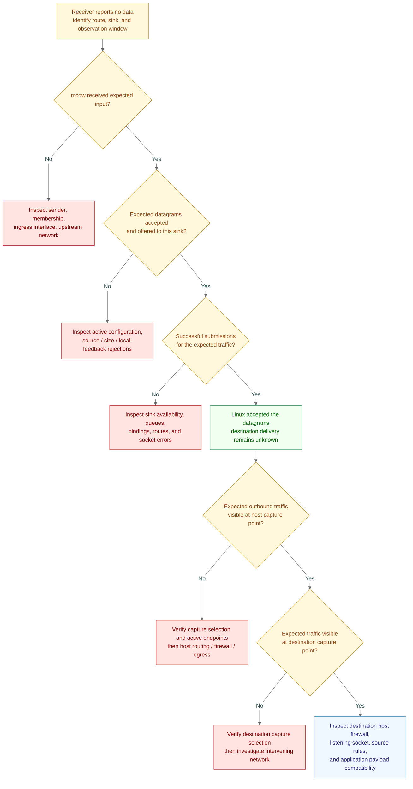
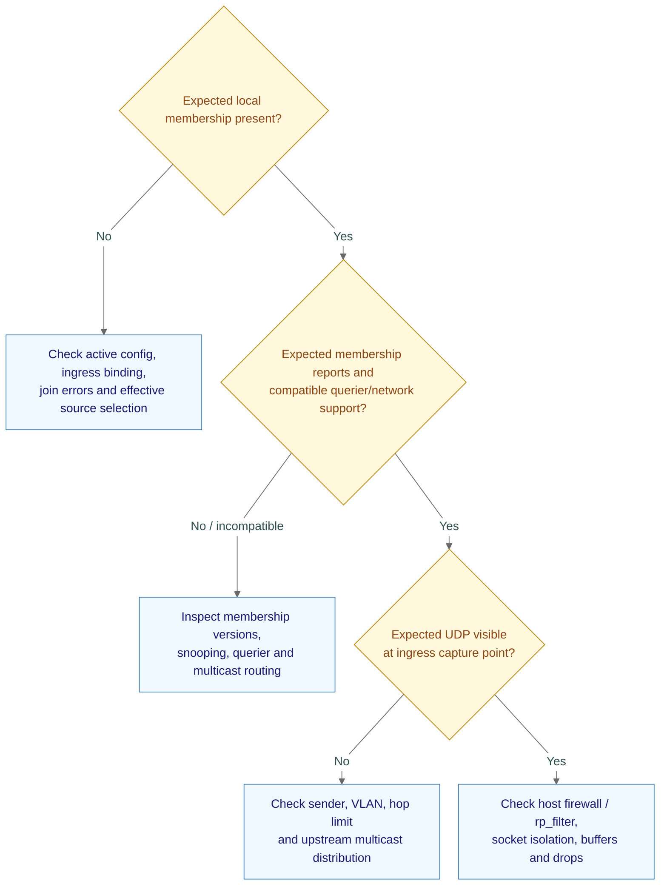

# mcgw troubleshooting

Operator walkthroughs for locating failures using evidence. mcgw is currently
an agreed design, not an implemented release. mcgw counters, status, and events
below are planned capabilities; exact field names and defaults remain open.
Packet captures are external diagnostic tools.

## Contents

- [Receiver sees no data](#receiver-sees-no-data)
- [Evidence checklist](#evidence-checklist)
- [Read-only checks](#read-only-checks)
- [Joined but no input](#joined-but-no-input)
- [Other symptoms](#other-symptoms)
- [Using packet captures](#using-packet-captures)
- [Related documents](#related-documents)

## Receiver sees no data

**Symptom:** the destination operator says their software is correctly
configured, but it receives nothing. mcgw may report successful submissions.

**Goal:** find the last point with evidence of the expected traffic, then
investigate the next boundary. Configuration claims alone do not establish
packet receipt. Follow one route and one destination sink at a time.



| Visual cue | Meaning |
|---|---|
| Amber | State, question, or control |
| Green | Local submission evidence; not destination confirmation |
| Rose | Failure/drop or investigation of it |
| Blue | Processing or investigation action |
| Arrow | Next diagnostic step; not packet flow |

An unknown answer means collect evidence at that step; do not assume “yes.”
If traffic is intermittent or only some messages are missing, repeat this path
for a small identifiable sample rather than treating all traffic as absent.

## Evidence checklist

| Step | Evidence to collect | Next action / limit |
|---|---|---|
| 1. Agree on the expected flow | Source, multicast group/port, ingress interface, route/sink IDs, destination IP/port, expected traffic interval | Confirm everyone is discussing the same feed and time window; record active configuration, not only the file on disk |
| 2. Confirm mcgw input | Per-route received packet/byte deltas; ingress capture when needed | No input: check source activity, interface, membership, VLAN and multicast infrastructure; traffic at a NIC capture point does not prove mcgw received it |
| 3. Check route acceptance | Rejection deltas and offers to the selected sink | Check source/size/local-feedback policy; match expected payloads where aggregate counters could include other traffic |
| 4. Check local sink outcomes | Availability, queue occupancy, submission/dropped/failed deltas, recent errors | A healthy input route can coexist with one failed sink; inspect `queue_full`, `expired`, `sink_unavailable`, `abandoned`, and locally reported size failures |
| 5. Verify actual endpoints | Active destination, source IP/port, egress constraint, local route selection | Confirm the destination expects the source mcgw actually uses; inspect stale configuration or an unintended path |
| 6. Capture outbound traffic | Expected payload, source/destination endpoints, chosen host capture point | A local submission count is not host-egress proof; capture evidence is specific to its observation point |
| 7. Capture at destination | Matching traffic during the same window | If absent, first validate the capture interface/filter; then trace routers, firewalls, routes, MTU, and loss between observation points |
| 8. Inspect destination delivery | Host firewall, listening address/UDP port, socket drops, source allow-list, payload format | A NIC capture can precede host filtering or socket delivery; seeing it there does not prove the application received it |
| 9. Correlate events | Journal outages/recoveries, interface/route changes, destination and network-device evidence | Tie changes to the failure window; an absent SIEM alert does not prove health |

### Source address and port are a common mismatch

| Endpoint | What the destination sees |
|---|---|
| Original sensor | Its endpoint belongs to the inbound multicast datagram |
| mcgw output | A new UDP datagram using mcgw's effective local source address/port |

A receiver or firewall allowing only the original sensor endpoint can reject
mcgw's output. With no fixed source bind, do not assume the source port equals
the multicast input port or remains unchanged after socket recreation.

### Review the journal

For a systemd deployment on Debian or RHEL:

```bash
sudo journalctl -u mcgw -f
```

Omit `-f` for existing logs. Restrict review to the incident window when useful.
Journal access may not require `sudo` for an authorized account. mcgw's planned
JSON events are stored in the journal message; SIEM collection/parsing is a
separate host integration. Transition logging is bounded, so packet counters
remain necessary for quantities.

## Read-only checks

Commands use the example `eth0`, group `239.1.1.1:3000`, destination
`10.0.20.5:3000`, and egress `eth1`. Replace these values. Run in mcgw's network
namespace when applicable. Tools may require installation or privileged access;
none of these commands changes forwarding configuration. Protocol commands and
counter availability vary by installed version.

### Planned mcgw endpoints

These commands require the implemented daemon and the default HTTP listener.
A connection failure can mean the service/listener is absent; it is not a packet-loss diagnosis.

```bash
curl --max-time 3 -sS -i http://127.0.0.1:9310/healthz
curl --max-time 3 -sS -i http://127.0.0.1:9310/readyz
curl --max-time 3 -sS http://127.0.0.1:9310/status
curl --max-time 3 -sS http://127.0.0.1:9310/metrics
```

| Evidence | Interpretation |
|---|---|
| Health/readiness response | 200/503 semantics are defined in architecture; readiness is local, not remote delivery |
| Status | Compare desired/applied config, actual endpoint and interface state |
| Metric snapshots | Compare deltas over the incident window; check process resets and unrelated traffic |
| Rejection reasons | Illustrative: `wrong_destination`, `wrong_ingress`, `source_filtered`, `self_loop`, `oversize`, `truncated` |
| Sink outcomes | Illustrative: submitted, failed, `queue_full`, `expired`, `sink_unavailable`, `abandoned`; identifiers remain provisional |

### Host and network checks

| Check | Command | Expected evidence / next step |
|---|---|---|
| Service state | `systemctl status mcgw` | Check startup failure/restarts; unit exists only after installation |
| Restart history | `systemctl show mcgw -p ActiveState -p SubState -p NRestarts` | Repeated restarts suggest lifecycle/boot/resource failure |
| Interface/address | `ip address show dev eth0` | Correct interface, address family, link state |
| Egress route | `ip route get 10.0.20.5` | Kernel-selected route/source; not a faithful substitute for all socket binding/mark/device constraints |
| Memberships | `ip maddress show dev eth0` | Host membership evidence, not proof of mcgw ownership/source-filter state |
| IPv4 membership detail | `cat /proc/net/igmp` | Compare group/interface and host compatibility state with wire reports |
| Socket memory | `sudo ss -uamnp` | Match mcgw sockets; inspect memory/drop evidence, not just presence |
| Host counters | `nstat -az` | Inspect available UDP receive/buffer and reverse-path counters; host-wide values are not per-route attribution |
| Reverse-path filtering | `sysctl net.ipv4.conf.all.rp_filter net.ipv4.conf.eth0.rp_filter` | Check effective policy against ingress source route; read values, do not blindly change them |
| Receive queue cap | `sysctl net.core.rmem_max` | Compare against requested/effective socket buffer accounting |
| Firewall | `sudo nft list ruleset` | Inspect active rules and counters where nftables is used |
| firewalld deployment | `sudo firewall-cmd --get-active-zones` then `sudo firewall-cmd --zone=ZONE --list-all` | Substitute actual zone; inspect interface/source assignment and policy |
| Network changes | `ip monitor link address route` | Observe relevant changes; stop after the diagnostic window |
| NIC offload settings | `ethtool -k eth0` | Explain capture representation; do not change offloads as a first diagnostic step |

### Bounded captures

```bash
sudo timeout 30 tcpdump -ni eth0 -c 100 'udp and dst host 239.1.1.1 and dst port 3000'
sudo timeout 30 tcpdump -ni eth1 -c 100 'udp and dst host 10.0.20.5 and dst port 3000'
sudo timeout 30 tcpdump -ni eth0 -c 100 'igmp'
sudo timeout 30 tcpdump -ni eth0 -c 100 'icmp6'
```

The last capture is deliberately broad: MLD uses ICMPv6 and extension headers can
make fixed-offset filters miss messages. Use a supported decoder/filter for
narrowing after inspecting the capture. Coordinate captures at the destination.
Capture visibility can precede host firewall/source-validation/socket delivery;
GRO and other offloads can change what host captures look like.

### Incident journal window

Replace the example timestamps with the actual window:

```bash
sudo journalctl -u mcgw --since '2026-10-16 10:00:00' --until '2026-10-16 10:05:00' -o cat
```

If `jq` is installed, pipe that output to
`jq -R 'fromjson? | select(.severity == "error")'` for planned JSON-severity
filtering. This skips non-JSON records; retain the original output for investigation.
JSON severity does not currently set native journal priority (OD-08).

## Joined but no input

Check the intended sender is actually transmitting first. Group membership
alone does not establish input delivery.



Membership reports may be suppressed/aggregated; absence in a short capture
is inconclusive. Source-specific requirements and querier details belong in
[deployment planning](mcgw-deployment.md#host-and-network-prerequisites).

## Other symptoms

| Symptom | Check | Expected evidence / next action |
|---|---|---|
| Intermittent loss | Compare planned `/metrics` deltas, socket/host counters, captures, CPU and queue occupancy | Separate receive overflow, local sink drops and unobserved network loss; capture drops can mimic loss |
| Feed starts, then stops | Membership/querier captures and switch/router state | Investigate snooping age-out, missing/incompatible queries, routing changes; do not assume a universal 260-second timer |
| Readiness fails but process lives | Planned `/status`, `/readyz`, interface state and journal | Identify affected required component; healthy sinks continue; no automatic restart solely for quiet traffic |
| Broken after reload | Desired/active generations and journal activation/rollback events | Verify active configuration, retained old instances and counted abandonment; rollback cannot restore discarded payloads |
| Duplicate messages | Active gateway instances, reflected paths, capture correlation | Overlapping memberships/workers or gateways can duplicate traffic; do not add payload hashing as a universal fix |
| Unexpected feed | Group/port/interface, source policy, rejection counters | Inspect multicast cross-delivery/isolation and unrelated host joins before blaming payload parsing |
| Small packets work, large ones do not | Path MTU, local size errors, ICMP/firewall evidence | PMTU black hole is possible even with successful local submissions |
| Source-specific feed missing | Membership source, sender identity, IGMP/MLD versions and router SSM config | Application allow-list is not a replacement for a working source-specific membership |
| Capture sees input, mcgw sees none | Ingress firewall/rp_filter, socket binding/isolation, buffers | Packet capture is not proof of socket delivery |
| Destination unreachable error | Planned sink error evidence and captures | UDP errors may refer to earlier sends; follow finite retry contract, not an unconditional retry workaround |
| Outgoing interface down | Planned sink availability and journal transition | Count `sink_unavailable`; verify constrained sink does not silently switch NIC |
| Destination capture sees traffic, app does not | Host filtering, socket binds/overflow, source allow-list, protocol decoder | Network firewall logs (including configured Palo Alto application policy) and application evidence may be needed; do not assert a vendor default |
| Incident timestamps disagree | Time synchronization and host time zones | Clock skew affects evidence correlation; it is not itself proof of packet reordering |

## Using packet captures

| Practice | Reason |
|---|---|
| Capture at both ends during a bounded window | Locate the boundary where evidence disappears |
| Use the expected UDP destination IP/port and correct interface | Avoid confusing another feed or missing traffic with a wrong filter |
| Record source IP/port and compare payloads | Correlate the new unicast datagram with the multicast input; original headers differ |
| Use identifiable test messages when authorized | Opaque repeated payloads and aggregate counters may not uniquely identify a packet |
| Check capture drop statistics and collection settings | Missing capture records can be a capture-tool limitation |
| Account for observation point, offload, and encapsulation | Host captures do not necessarily represent physical-wire packets or the application's received view |
| Keep capture time/size bounded and handle payloads appropriately | Avoid filling storage or unnecessarily retaining sensor contents |

mcgw does not require a cooperating destination receiver or add delivery probes.
Destination-side capture is optional troubleshooting cooperation. If it is
unavailable, report the last confirmed observation point and the remaining
unknown path; do not turn local submission success into a delivery claim.

## Related documents

- [Concepts](mcgw-concepts.md): terminology, local confirmation boundary, logs and metrics.
- [Architecture](architecture.md): authoritative scope, accounting, interface recovery, and operational contracts.
- [Architecture review and sources](architecture-review.md#appendix-a--online-research-sources): design rationale and transport/kernel references.

Command references: [research appendix S18–S22](architecture-review.md#appendix-a--online-research-sources). Tool presence, privileges, namespace, and release qualification remain deployment prerequisites.
